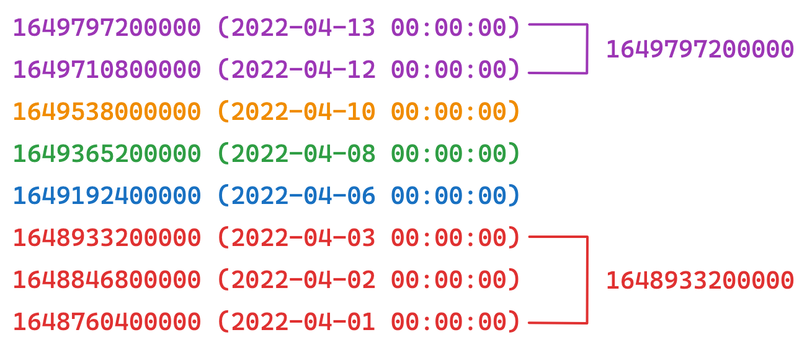

# E-Commerce Data Engineering Case Study

The diagram below shows the data pipeline. The task is to write batch Spark applications using data from the file system.

<br />

## Data

You will work with Clickstream, Order, and Product data, available in the `/raw-data` directory.

### **Clickstream**

- Each `user` has a unique `user_id` and a `sid` (session ID) that changes every 30 minutes.
- A user can generate multiple events, and a product (`product_id`) can have multiple events.
- `event` can have the following values:
    - impression
    - add_to_fav
    - add_to_basket
    - purchase
- `platform` can have the following values:
    - ios
    - android
    - web
    - mweb

```json
{
  "user_id":3234019,        // Unique user ID
  "platform":"ios",         // User device platform: ios | android | web | mweb
  "product_id":16350963,    // Unique product ID
  "event":"impression",     // User event for the product: impression | add_to_fav | add_to_basket | purchase
  "sid":"b5d2e908b0de1090", // Unique session ID
  "timestamp":1697490000000 // Time of the event
}
```

### Order

The following rules apply to order data. An example order record is shown below.

- An `itemId` cannot belong to more than one `orderId`.
- An `orderId` has at least one `itemId`.
- A `productId` can have multiple `itemId` values.
    - For example, two item IDs for a product indicate that two units of that product were purchased.
- An `itemId` can have multiple statuses.
- `statusCreatedDate` is the time when a status was created for an `itemId`.
- `status` can have the following values:
    - `CREATED`: The order was created.
    - `DELIVERED`: The item was delivered to the user.
    - `CANCELLED`: The item was cancelled.
    - `RETURN_ACCEPTED`: The item was returned.
- An item's status history follows these rules:
    - An order must first be created.
    - After creation, an order can be delivered or cancelled.
    - After delivery, an order can be returned.

```json
{
  "orderId": 5678526598,             // Order ID
  "userId": 52659,                   // User ID
  "orderDate": 1697749603808,        // Order creation time
  "price": 299.99,                   // Price of the purchased item
  "itemId": 23455265982,             // Purchased item ID
  "productId": 11719478,             // Product ID of the purchased item
  "statusCreatedDate": 1697894266529,// Time when the item's status was created
  "status": "DELIVERED"              // Item status
}
```

### **Product**

Product data contains information about each product and is unique by product ID. A product can be associated with multiple genders.

```json
{
  "productId": 8441421,          // Product ID
  "categoryName": "Cardigan",   // Product category name
  "gender": ["female", "male"]  // Genders associated with the product
}
```

## Batch Processing

We want to build each user's *E-Commerce Journey* using their activity in the e-commerce application.

### Problem-1

For each user's top five categories by **clickstream** event count, calculate:

- The average event count over the last three days **on which the user generated events**.
- The average event count over the last three calendar days, ending on the user's latest event date.
- Net amount spent.
- Gross number of items purchased.
- Gross number of orders.

*Note:* Exclude items whose final status is cancelled or returned when calculating net spending.

*Note:* Creating an `itemId` is sufficient for it to count toward gross metrics.

**Input**

Use the order, clickstream, and product data.

**Output**

Write the results in *JSON* format as shown below.

```json
{
"userId": 12222222,                           // Long
"categoryName": "Cardigan",                  // String
"gender": "female",                           // String
"last3DayAverageClickCount": 3.50,            // Double
"lastInteracted3DayAverageClickCount": 3.40,  // Double
"netPrice": 90.30,                            // Double
"grossItemCount": 2,                          // Long
"grossOrderCount": 3                          // Long
}
```

### Problem-2

We want to analyze how frequently users interact with the e-commerce application. Treat each run of consecutive active days as a cluster and use clickstream data to calculate:

- The average daily event count for each cluster.
- The number of days in the largest cluster.
- The average change in daily event counts within each cluster.

*Note:* Name each cluster using the date of its first day.

*Consecutive days:* Successive calendar days on which a user was active in the e-commerce application. In the example below, only the dates shown in **purple** and **red** form runs of consecutive days.

<br />

*Note:* If any required metric is unavailable for a user, exclude that user from the results.

**Input**

Use the clickstream data. Each row represents an event generated by a user in the application.

**Output**

Write the results in *JSON* format as shown below.

```json
{
  "userId": 122222222,            // Long
  "firstDayOfSet": 1698872400000, // Long
  "avgClickCount": 3.60,          // Double
  "maxInteractedDayCount": 4,     // Long
  "avgIncrease": -5.80            // Double
}
```

## Evaluation Criteria

- Performance
- Type Safety
- Code Quality
- Results
- Tests
- Documentation

## Calculation rules and assumptions

- All dates use UTC, explicitly configured in the Spark session.
- Problem 1 ranks categories by original event count per user, before gender expansion. Exactly five categories are selected when available; category name ascending breaks ties. Each selected category can produce multiple gender rows.
- `lastInteracted3DayAverageClickCount` averages counts on the latest three distinct active days for each user/category/gender. If fewer days exist, the denominator is the number of available active days.
- `last3DayAverageClickCount` sums counts on the latest event date and the preceding two calendar days for each user/category/gender, then divides by three. Missing days contribute zero. Other users' event dates do not affect this window.
- Net price counts each item's latest status once, excluding `CANCELLED` and `RETURN_ACCEPTED`; a latest `CREATED` status is included. Gross item/order counts are distinct item/order IDs, including cancelled or returned items.
- Equal status timestamps prefer `RETURN_ACCEPTED`, then `CANCELLED`, `DELIVERED`, and `CREATED`. Further ties use order ID, product ID and price.
- Problem 2 reads original Bronze events, before product enrichment. A cluster contains at least two consecutive active days; isolated days are excluded. Users with no such cluster produce no output.
- `avgIncrease` is calculated per cluster as the mean of chronological day-to-day event-count differences, without crossing cluster boundaries. `maxInteractedDayCount` is the user's longest eligible cluster.
- Problem 1 categories without matching order metrics receive zero order metrics. Events without product categories cannot participate in category ranking; they still contribute to Problem 2.
- Explicit schemas do not replace data-quality validation. Full malformed-record quarantine and status-transition validation are not implemented.

## Implementation

Bronze and Silver outputs use Parquet; final Gold outputs use JSON. Transformations use explicit input schemas and partitioned Spark windows. The local Spark configuration uses eight shuffle partitions and should be adjusted for a larger deployment.

## How to Use

This project is designed to run as a batch-oriented Spark pipeline using Docker for environment consistency.

## Prerequisites

- Docker 
- Docker Compose

## Build and Start the Environment

- Build and Start the project:

```bash
docker-compose build
docker-compose up -d
```

## Raw Data Preparation

All input data is located under the /raw-data directory.

If the data is provided in compressed format (.zip), ensure that the files are extracted before running the pipeline:

```bash
cd raw-data
unzip clickstream.json.zip -d clickstream
unzip order.json.zip -d order
unzip product.json.zip -d product
```

- Connect to the Spark container:

```bash
docker-compose exec spark-app bash
```

## Run the Pipeline

The pipeline must be executed sequentially, following the medallion architecture.
Run all seven jobs from the container with one command (stops on the first failure):

```bash
bash scripts/run_pipeline.sh
```

The individual commands below are also available.

### Bronze Layer – Raw Ingestion

```python
python src/jobs/bronze_clickstream.py
python src/jobs/bronze_product.py
python src/jobs/bronze_order.py
```

Purpose:

- Read raw JSON data
- Enforce schemas
- Perform minimal transformations


### Silver Layer – Business Preparation

```python
python src/jobs/silver_clickstream.py
python src/jobs/silver_order.py
```

Purpose:

- Enrich clickstream with product metadata
- Derive business-ready metrics
- Prepare data for analytical use cases


### Gold Layer – Final Outputs

Problem-1:

```python
python src/jobs/gold_problem1.py
```

Output directory:

```bash
output/gold/problem1
```

Problem-2:

```python
python src/jobs/gold_problem2.py
```

Output directory:

```bash
output/gold/problem2
```

## Validate Outputs

You can inspect the generated JSON outputs directly:

```bash
cat output/gold/problem1/part-*.json | head
cat output/gold/problem2/part-*.json | head
```

Each output record strictly follows the formats defined in the problem statements.


## Testing

Run the regression suite inside the container:

```bash
docker-compose exec spark-app python -m pytest tests -v
```

Tests cover returned/cancelled/created item histories, repeated status records, equal status timestamps, active versus calendar days, retention of older users, deterministic top-five category ties, missing order metrics, empty inputs, chronological cluster changes and isolated days. Job-level integration tests exercise Parquet inputs and JSON outputs, including category ranking before gender expansion and Problem 2 execution without Silver/product data.

Validation after the calculation fixes:

- `13 passed` using PySpark 3.5.0, Python 3.12.10 and Java 17.
- All seven jobs were executed for users `85`, `711`, `863`, `942` and `3234019`, retaining their complete histories from the supplied archives. All 46 Problem 1 rows and 8 Problem 2 rows matched a separate Python reference calculation on every field.
- The Docker image build was not verified in this run because the Docker daemon was unavailable.

## Verified sample output

The records below were generated from the sampled original data after the fixes. The Problem 1 category label is translated into English for display; pipeline outputs preserve the source category names.

Problem 1:

```json
{"categoryName": "Casual Shoes", "gender": "female", "grossItemCount": 0, "grossOrderCount": 0, "last3DayAverageClickCount": 0.3333333333333333, "lastInteracted3DayAverageClickCount": 1.0, "netPrice": 0.0, "userId": 85}
```

Problem 2:

```json
{"avgClickCount": 6.5, "avgIncrease": -11.0, "firstDayOfSet": 1698451200000, "maxInteractedDayCount": 2, "userId": 85}
{"avgClickCount": 17.6, "avgIncrease": 0.5, "firstDayOfSet": 1697846400000, "maxInteractedDayCount": 5, "userId": 711}
```

### Notes 

- This batch pipeline can also be orchestrated using Apache Airflow, where each layer
  (Bronze, Silver, Gold) can be modeled as separate tasks within a DAG.
  This would allow scheduling, retry mechanisms, monitoring, and better operational control
  for production-grade deployments.

- This pipeline could also be deployed and executed in a Kubernetes environment (e.g. Spark on Kubernetes or a Kubernetes-native data platform). The current architecture remains fully compatible with a future migration to Kubernetes if required.

- Input archives must be extracted before ingestion. The jobs read the extracted JSON directories, not the ZIP archives.
