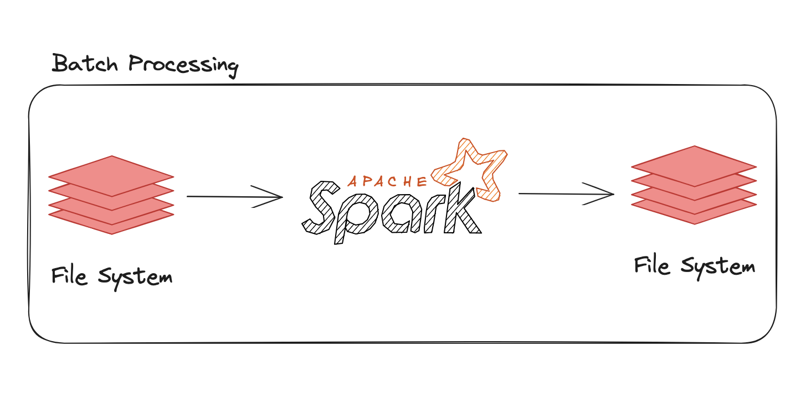

# E-Ticaret Data Engineering Case Study

Diyagramlarda Data Pipeline’larını görüyorsunuz. Sizden beklentimiz;

- Dosya sistemindeki verileri kullanarak batch Spark uygulamaları yazmanız.
  
<br />

## Data

Clickstream, Order ve Product verileri üzerinde çalışacaksınız. Bu verilere `/raw-data` dizininde ulaşabilirsiniz.

### **Clickstream**

- Bir `user`'ın unique `user_id`’si olurken her 30 dk değişen `sid(session_id)`’si vardır.
- Bir `user`'a ait birden fazla `event` olabilir, aynı şekilde bir `product <product_id>`'a ait birden fazla event olabilir.
- `Event`’in alabileceği değerler aşağıdaki gibidir:
    - impression
    - add_to_fav
    - add_to_basket
    - purchase
- `Platform`’un alabileceği değerler aşağıdaki gibidir:
    - ios
    - android
    - web
    - mweb


```json
{
  "user_id":3234019,        // User'ların unique id'leri
  "platform":"ios",         // User'ların device bilgisi: ios | android | web | mweb
  "product_id":16350963,    // Product'ların unique id'leri 
  "event":"impression",     // User'ın ilgili product için attığı event: impression | add_to_fav | add_to_basket | puchase
  "sid":"b5d2e908b0de1090", // User'ların unique session id'leri
  "timestamp":1697490000000 // Event'in gerçekleştiği zaman
}
```

### Order

Sipariş verisine ait dikkat edimesi gerekenler ve örnek bir sipariş aşağıdaki gibidir.

- Bir `itemId` birden fazla `orderId`’ye sahip olamaz.
- Bir `orderId` en az bir `itemId`’ye sahiptir.
- Bir `productId`’nin birden fazla `itemId`’si olabilir.
    - Örneğin, bir ürünün 2 adet `itemId`’si varsa bu üründen 2 adet almış demektir.
- Bir `itemId`’nin birden fazla `status`’ü olabilir.
- `statusCreatedDate` bir `itemId`’nin `status`’ünün oluşturulma tarihidir.
- Bir `status` aşağıdaki değerlere sahip olabilir:
    - `CREATED` : Siparişin oluşturulması
    - `DELIVERED` : Ürünün kullanıcıya teslim edimesi
    - `CANCELLED` : Ürünün iptal edilmesi
    - `RETURN_ACCEPTED` : Ürünün iade edilmesi
- Bir `Item`'ın status geçmişi aşağıdaki gibi olabilir
    - Bir sipariş oluşturulmuş olmalıdır.
    - Bir sipariş oluşturulduktan sonra teslim edilmiş veya iptal edilmiş olabilir.
    - Bir sipariş teslim edildikten sonra iade edilebilir.

```json
{
  "orderId": 5678526598,             // Siparişin id'si
  "userId": 52659,                   // Kullanıcı id'si
  "orderDate": 1697749603808,        // Siparişin oluşturulma tarihi
  "price": 299.99,                   // Satılan ürünün fiyatı.
  "itemId": 23455265982,             // Satılan ürünün id'si
  "productId": 11719478,             // Satılan ürünün ürün id'si
  "statusCreatedDate": 1697894266529,// Satılan ürünün ilgili statüsünün oluşturma tarihi
  "status": "DELIVERED"              // Satılan ürünün statüsü 
}
```

### **Product**

Ürün verisi bir ürünün bilgilerini içerir. Veri product id bazında tekildir. Ürün birden fazla cinsiyet bilgisine sahip olabilir.

```json
{
  "productId": 8441421,          // Ürünün id'si
  "categoryName": "Hırka",      // Ürünün kategorisinin ismi
  "gender": ["female", "male"]  // Ürünün cinsiyet bilgisi.
}
```

## Batch Processing

Kullanıcıların E-Ticaret uygulamasındaki verilerini kullanılarak kullanıcılara ait *E-Ticaret Journey* oluşturmak istiyoruz.

### Problem-1

Her bir kullanıcının en çok **clickstream** eventi oluşturduğu ilk 5 category için;

- **Event oluşturduğu** son 3 günün event sayısının ortalamasını
- En son eventinden itibaren, son 3 günün event sayısının ortalaması
- Net harcadığı para
- Brüt satın aldığı ürün sayısı
- Brüt sipariş sayısı

*Not:* Eğer bir `item`’ın `status`’u iptal veya iade ile sonuçlandıysa net hesaplarken kullanmıyoruz.

*Not:* Brüt hesabı yapmak için bir `itemId`’nin oluşturulması yeterlidir.

**Input**

Input için order, clickstream ve product verilerini kullanacağız.

**Output**

Sonucu aşağıdaki gibi *JSON* formatında yazmanızı bekliyoruz.
```json
{
"userId": 12222222,                           // Long
"categoryName": "Hırka",                      // String
"gender": "female",                           // String
"last3DayAverageClickCount": 3.50,            // Double
"lastInteracted3DayAverageClickCount": 3.40,  // Double
"netPrice": 90.30,                            // Double
"grossItemCount": 2,                          // Long
"grossOrderCount": 3                          // Long
}
```

### Problem-2

Kullanıcıların E-Ticaret uygulamasını kullanma sıklıklıklarını analiz etmek istiyoruz. Bu hedef doğrultusunda kullanıcıların arka arkaya girdiği günlerin her birini bir küme olarak düşünürsek,  clickstream verisini kullanarak aşağıdakileri hesaplamak istiyoruz.

- Her küme için event sayılarının ortalaması
- En büyük kümenin gün sayısı
- Kümelerin içindeki günlerin event sayılarının değişim ortalaması

*Note*: Kümeleri içerisinde bulunan ilk günün tarihiyle isimlendiriyoruz.

*Peş Peşe günler:* Gün bazında ardı ardına E-Ticaret’da geçirdiği günlerdir. Aşağıdaki örnekte sadece **mor** ve **kırmızı** renkte olan tarihler peş peşe olan günlerdir.

<br />

*Not:* Bir kullanıcının istediğimiz metriklerden herhangi birisine sahip değilse, o kullanıcının metriklerinin hesaplanmasını istemiyoruz.

**Input**

Input için clickstream verisini kullanacağız. Burada bulunan her tekil satır, bir kullanıcının uygulamada oluşturduğu bir eventtir.

**Output**

Sonucu aşağıdaki gibi *JSON* formatında yazmanızı bekliyoruz.

```json
{
  "userId": 122222222,            // Long
  "firstDayOfSet": 1698872400000, // Long
  "avgClickCount": 3.60,          // Double
  "maxInteractedDayCount": 4,     // Long
  "avgIncrease": -5.80            // Double
}
```

## Değerlendirme Kriterlerimiz

- Performans
- Type Safety
- Kod Kalitesi
- Sonuçlar
- Testler
- Dokümantasyon

## Calculation rules and assumptions

- All dates use UTC, explicitly configured in the Spark session.
- Problem 1 ranks categories by original event count per user, before gender expansion. Exactly five categories are selected when available; category name ascending breaks ties. Each selected category can produce multiple gender rows.
- `lastInteracted3DayAverageClickCount` averages counts on the latest three distinct active days for each user/category/gender. If fewer days exist, the denominator is the number of available active days.
- `last3DayAverageClickCount` sums counts on the latest event date and the preceding two calendar days for each user/category/gender, then divides by three. Missing days contribute zero. Other users' event dates do not affect this window.
- Net price counts each item's latest status once, excluding `CANCELLED` and `RETURN_ACCEPTED`; a latest `CREATED` status is included. Gross item/order counts are distinct item/order IDs, including cancelled or returned items.
- Equal status timestamps prefer `RETURN_ACCEPTED`, then `CANCELLED`, `DELIVERED`, and `CREATED`. Further ties use order ID, product ID and price.
- Problem 2 reads original Bronze events, before product enrichment. A cluster contains at least two consecutive active days; isolated days are excluded. Users with no such cluster produce no output.
- `avgIncrease` is calculated per cluster as the mean of chronological day-to-day event-count differences, without crossing cluster boundaries. `maxInteractedDayCount` is the user's longest eligible cluster.
- Problem 1 categories without matching order metrics receive zero order metrics. Events without product categories cannot participate in category ranking; they still contribute to Problem 2.
- Explicit schemas do not replace data-quality validation. Full malformed-record quarantine and status-transition validation are not implemented.

## Implementation

Bronze and Silver outputs use Parquet; final Gold outputs use JSON. Transformations use explicit input schemas and partitioned Spark windows. The local Spark configuration uses eight shuffle partitions and should be adjusted for a larger deployment.

## How to Use

This project is designed to run as a batch-oriented Spark pipeline using Docker for environment consistency.

## Prerequisites

- Docker 
- Docker Compose

## Build and Start the Environment

- Build and Start the project:

```bash
docker-compose build
docker-compose up -d
```

## Raw Data Preparation

All input data is located under the /raw-data directory.

If the data is provided in compressed format (.zip), ensure that the files are extracted before running the pipeline:

```bash
cd raw-data
unzip clickstream.json.zip -d clickstream
unzip order.json.zip -d order
unzip product.json.zip -d product
```

- Connect to the Spark container:

```bash
docker-compose exec spark-app bash
```

## Run the Pipeline

The pipeline must be executed sequentially, following the medallion architecture.
Run all seven jobs from the container with one command (stops on the first failure):

```bash
bash scripts/run_pipeline.sh
```

The individual commands below are also available.

### Bronze Layer – Raw Ingestion

```python
python src/jobs/bronze_clickstream.py
python src/jobs/bronze_product.py
python src/jobs/bronze_order.py
```

Purpose:

- Read raw JSON data
- Enforce schemas
- Perform minimal transformations


### Silver Layer – Business Preparation

```python
python src/jobs/silver_clickstream.py
python src/jobs/silver_order.py
```

Purpose:

- Enrich clickstream with product metadata
- Derive business-ready metrics
- Prepare data for analytical use cases


### Gold Layer – Final Outputs

Problem-1:

```python
python src/jobs/gold_problem1.py
```

Output directory:

```bash
output/gold/problem1
```

Problem-2:

```python
python src/jobs/gold_problem2.py
```

Output directory:

```bash
output/gold/problem2
```

## Validate Outputs

You can inspect the generated JSON outputs directly:

```bash
cat output/gold/problem1/part-*.json | head
cat output/gold/problem2/part-*.json | head
```

Each output record strictly follows the formats defined in the problem statements.


## Testing

Run the regression suite inside the container:

```bash
docker-compose exec spark-app python -m pytest tests -v
```

Tests cover returned/cancelled/created item histories, repeated status records, equal status timestamps, active versus calendar days, retention of older users, deterministic top-five category ties, missing order metrics, empty inputs, chronological cluster changes and isolated days. Job-level integration tests exercise Parquet inputs and JSON outputs, including category ranking before gender expansion and Problem 2 execution without Silver/product data.

Validation after the calculation fixes:

- `13 passed` using PySpark 3.5.0, Python 3.12.10 and Java 17.
- All seven jobs were executed for users `85`, `711`, `863`, `942` and `3234019`, retaining their complete histories from the supplied archives. All 46 Problem 1 rows and 8 Problem 2 rows matched a separate Python reference calculation on every field.
- The Docker image build was not verified in this run because the Docker daemon was unavailable.

## Verified sample output

The records below were generated from the sampled original data after the fixes.

Problem 1:

```json
{"categoryName": "Casual Ayakkabı", "gender": "female", "grossItemCount": 0, "grossOrderCount": 0, "last3DayAverageClickCount": 0.3333333333333333, "lastInteracted3DayAverageClickCount": 1.0, "netPrice": 0.0, "userId": 85}
```

Problem 2:

```json
{"avgClickCount": 6.5, "avgIncrease": -11.0, "firstDayOfSet": 1698451200000, "maxInteractedDayCount": 2, "userId": 85}
{"avgClickCount": 17.6, "avgIncrease": 0.5, "firstDayOfSet": 1697846400000, "maxInteractedDayCount": 5, "userId": 711}
```

### Notes 

- This batch pipeline can also be orchestrated using Apache Airflow, where each layer
  (Bronze, Silver, Gold) can be modeled as separate tasks within a DAG.
  This would allow scheduling, retry mechanisms, monitoring, and better operational control
  for production-grade deployments.

- This pipeline could also be deployed and executed in a Kubernetes environment (e.g. Spark on Kubernetes or a Kubernetes-native data platform). The current architecture remains fully compatible with a future migration to Kubernetes if required.

- Input archives must be extracted before ingestion. The jobs read the extracted JSON directories, not the ZIP archives.
